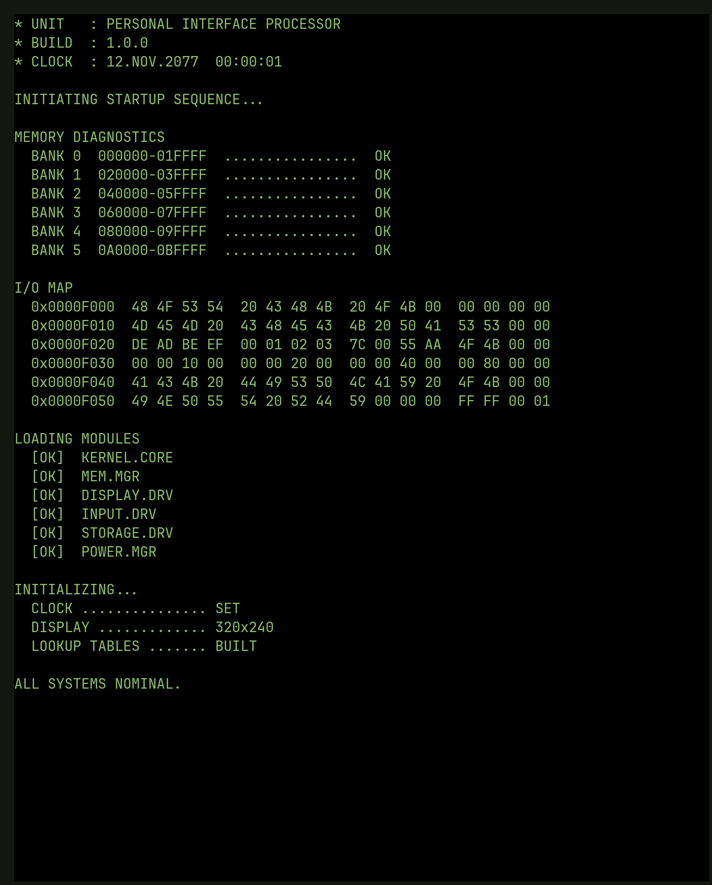
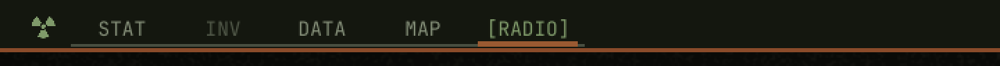

# Wasteland

A dark, muted post-apocalyptic theme for [Omarchy](https://omarchy.org): dusty
olive, rust and amber instead of bright phosphor green. It's an original theme
inspired by retro-futurist wasteland games.

The theme is the usual Omarchy kind: one `colors.toml`, one original wallpaper
and an icon set. It works on its own. An **optional extras add-on** in
`extras/` goes further and themes the lock screen, screensaver, login and bar
as well. Low-heat by design: no blur, transparency or shaders anywhere.

## Install the theme

    omarchy theme install https://github.com/ventu/omarchy-wasteland-theme

Or use **Install > Style > Theme** in the Omarchy menu and paste the URL.
The theme shows up as **Wasteland** in the theme picker (`Super + Ctrl + T`).

That's all the core theme needs. Terminal, Hyprland borders, btop, Neovim,
Chromium, VS Code and the Omarchy shell all take their colours from
`colors.toml`.

## Optional extras

| | |
|---|---|
|  |  |
| **Pip-Boy lock screen.** PIP-OS styling with the Vault Boy mascot, plus a CRT power-off when it locks and a power-on when it unlocks. | **Overseer screensaver.** Terminal logs type out slowly beside a radiation trefoil. It uses almost no CPU. |
|  |  |
| **Boot animation** after login (press any key to skip). | It ends on a splash, then the desktop powers on. |

**Bar:** workspaces 1-5 become STAT / INV / DATA / MAP / RADIO tabs (you can rename them; see [Customize tab names](#customize-tab-names)). A rust
line runs under the bar, the Omarchy logo becomes a radiation trefoil (still
the menu button), and the clock reads `15.NOV.2026 13:37`.

The extras switch on only while Wasteland is the current theme. Pick any other
theme and you get Omarchy's stock lock screen (without blur), screensaver,
workspaces, clock and logo back automatically.

### Install the extras

Needs Omarchy 4.5 or newer. Tested on Omarchy 4.5.0-3 with Hyprland 0.56 on a
MacBook Pro and a Lenovo laptop. Install the theme first, then:

    bash ~/.config/omarchy/themes/wasteland/extras/install.sh

The installer:

- refuses to run as root (no sudo needed) or while the screen is locked
- copies everything it replaces to `~/.local/state/omarchy/wasteland-backups/<timestamp>/` first
- copies five shell plugins to `~/.config/omarchy/plugins/`: `wasteland.lock`,
  `wasteland.idle`, `wasteland.workspaces`, `wasteland.clock` and
  `wasteland.menubutton`. It switches them on with `omarchy plugin enable`, so
  Omarchy edits its own `shell.json`. The installer never writes it.
- adds a theme-set hook, `~/.config/omarchy/hooks/theme-set.d/20-wasteland-extras`,
  which turns the extras on and off as you change themes
- adds `~/.config/hypr/wasteland.lua`, which holds the boot window and CRT
  layer rules and the boot autostart, plus one
  `require("hypr.wasteland")` line at the end of `~/.config/hypr/hyprland.lua`
- links `~/.local/bin/wasteland-boot`
- copies the feature switches to `~/.config/omarchy/wasteland/features.conf`

Run it again after `omarchy theme update` to pick up new plugin versions.

### Turn single extras off

Edit `~/.config/omarchy/wasteland/features.conf`:

    BOOT=1          # boot animation after login
    LOCK_VIEW=1     # Pip-Boy lock screen (0 = Omarchy-style lock, no blur)
    CRT=1           # tube-TV power-off/on: lock, unlock, login, shutdown, reboot
    SCREENSAVER=1   # overseer screensaver
    BAR_TABS=1      # STAT INV DATA MAP RADIO workspace tabs
    TAB_LABELS=STAT,INV,DATA,MAP,RADIO   # tab names, see below
    STATUS_STRIP=1  # rust line, trefoil menu button, Wasteland clock

then run `omarchy theme set wasteland` again.

### Try them without waiting

    ~/.local/bin/wasteland-boot --force                                      # boot animation
    ~/.config/omarchy/themes/wasteland/extras/bin/wasteland-screensaver force  # screensaver
    omarchy-shell lock crtOn                                                 # CRT power-on

### Uninstall

    bash ~/.config/omarchy/themes/wasteland/extras/uninstall.sh

This puts Omarchy's stock lock screen, idle service, workspaces, clock and menu
button back through `omarchy plugin enable/disable`. It also moves the plugins,
hook and Hyprland file into a backup folder and removes the `require` line.
Add `--purge` to delete your `features.conf` too. Then pick another theme, or
remove this one with `omarchy theme remove wasteland`.

Remove the extras **before** you remove the theme. The lock plugin keeps
working without the theme (it falls back to the stock look), but the add-on
scripts live in the theme folder.

### Good to know

- The extras clone four of Omarchy's own plugins (`omarchy.lock`, `omarchy.idle`,
  `omarchy.workspaces`, `omarchy.clock`). A big Omarchy update may change
  those. If something looks off after an update, run `uninstall.sh`, and
  please open an issue.
- If your bar already uses another workspaces or clock replacement, the
  Wasteland one is added next to it rather than replacing it.
- `omarchy theme install` drops `.lua` files and terminal configs from themes
  installed from git. That's why the Hyprland rules are only installed by the
  extras script, which you run yourself.

## Customize tab names

With the extras installed, the bar shows workspaces 1-5 as STAT / INV / DATA /
MAP / RADIO. To use your own names:

1. Open `~/.config/omarchy/wasteland/features.conf` (install.sh creates it).
2. Edit or add the `TAB_LABELS` line. Names are comma-separated and go to
   workspaces 1, 2, 3... in order, up to 10:

       TAB_LABELS=CODE,WEB,CHAT,MUSIC,MAIL

   - Workspaces past the end of the list show their number. Leave a name
     empty (`CODE,,CHAT`) to keep that workspace's number.
   - Spaces around names are ignored, and quotes around the whole value are
     optional. Short names keep the bar compact.
   - `TAB_LABELS=` (blank) or deleting the line brings back the defaults.

3. Apply it:

       omarchy theme set wasteland

   The bar updates within a second; no restart needed.

`BAR_TABS=0` in the same file turns the tabs off and shows plain workspace
numbers. The lock screen keeps its own STAT / INV / DATA / MAP / RADIO tabs.

## Files

    colors.toml, icons.theme, backgrounds/, preview.png   the theme
    extras/install.sh, extras/uninstall.sh                optional add-on
    extras/plugins/wasteland.*                            shell plugins (QML)
    extras/bin/                                           boot animation, screensaver
    extras/assets/                                        trefoil artwork (SVG, PNG, text)
    extras/hooks/, extras/hypr/                           theme-set hook, Hyprland rules
    extras/features.conf, extras/on-theme-set             feature switches
    images/                                               screenshots

## Credits

- Theme, wallpaper, trefoil drawing, and all boot and screensaver text by
  Matt Volz. All are original. The wallpaper was
  generated from scratch, with no third-party art or logos. The trefoil is the
  standard radiation hazard symbol, newly drawn.
- The extras plugins are modified copies of Omarchy's own shell plugins,
  © David Heinemeier Hansson, MIT licensed. See `NOTICE.md`.
- Vault Boy, Pip-Boy and PIP-OS are trademarks of Bethesda Softworks LLC
  (Fallout). The lock screen mascot
  (`extras/plugins/wasteland.lock/pipboy-mascot.png`) and the PIP-OS lock text
  are non-commercial fan art. They are not covered by this theme's MIT license.
  This theme is not affiliated with or endorsed by Bethesda or ZeniMax.
- Not affiliated with or endorsed by Omarchy.

## License

MIT. See `LICENSE`.
