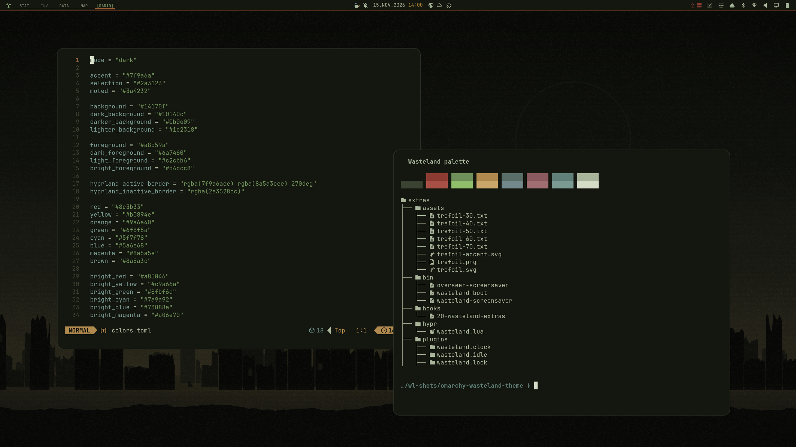
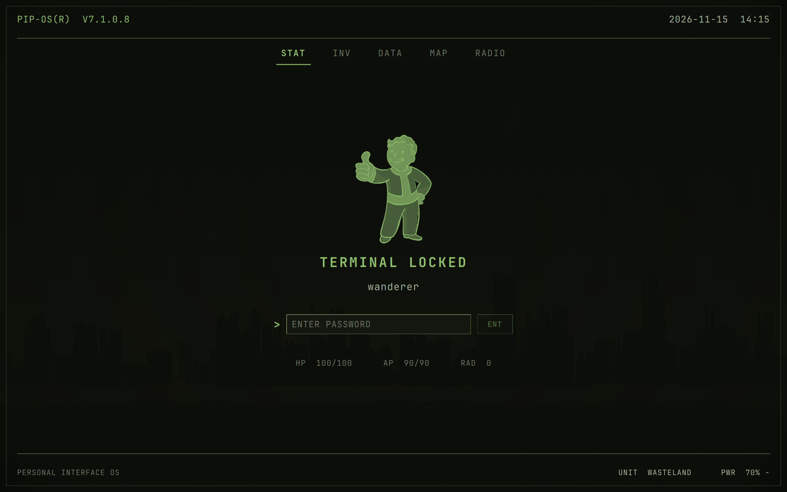
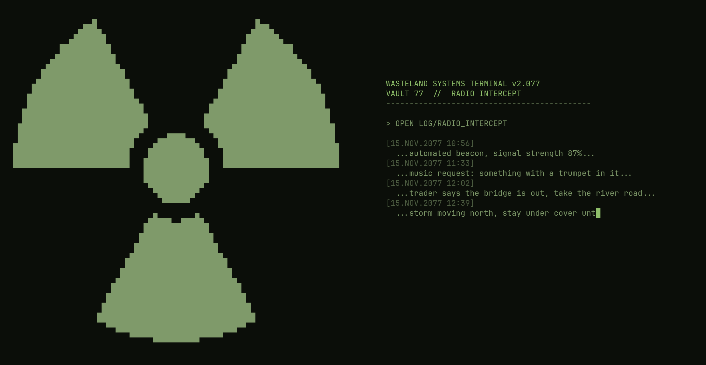
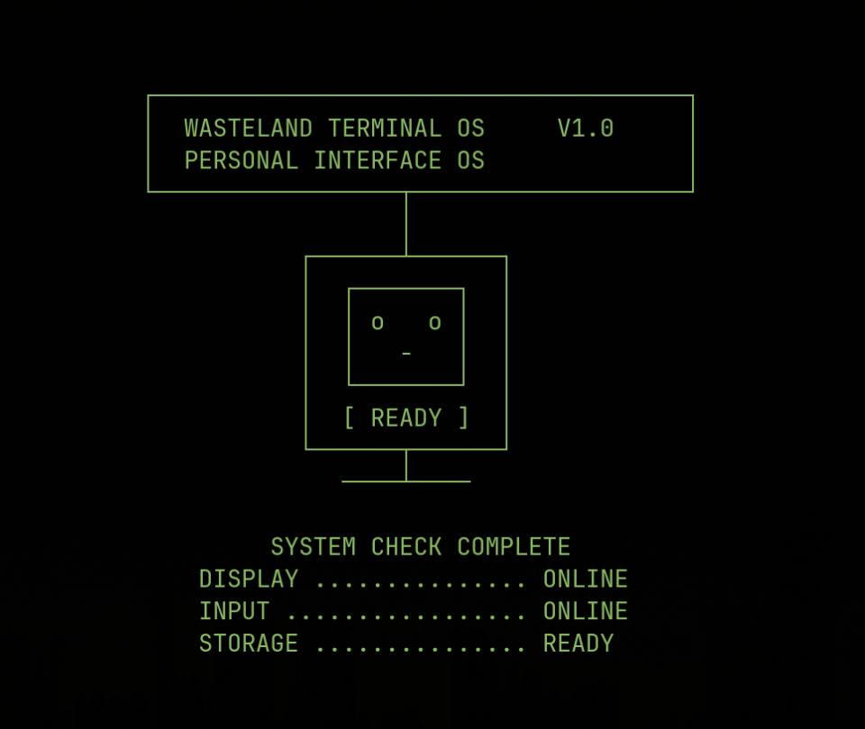
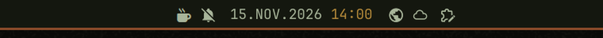

# Wasteland

A dark, worn-in post-apocalyptic theme for [Omarchy](https://omarchy.org).
Think dusty olive, rust and amber instead of the usual bright phosphor green.
It's an original theme, inspired by retro-futurist wasteland games.

At its core, it's a regular Omarchy theme: a `colors.toml`, an original
wallpaper and an icon set, and that's all you need. If you want to go all in,
the **optional extras** in `extras/` also dress up your lock screen,
screensaver, login and bar. Everything is kept light on purpose, with no blur,
transparency or shaders, so your laptop stays cool and quiet.

## Install the theme

    omarchy theme install https://github.com/ventu/omarchy-wasteland-theme

Or use **Install > Style > Theme** in the Omarchy menu and paste the URL.
The theme shows up as **Wasteland** in the theme picker (`Super + Ctrl + T`).

That's it for the core theme. Your terminal, Hyprland borders, btop, Neovim,
Chromium, VS Code and the Omarchy shell all pick up the new colors
automatically.

## Optional extras

| | |
|---|---|
|  |  |
| **Pip-Boy lock screen.** PIP-OS styling with the Vault Boy mascot. The screen switches off like an old CRT when you lock it and flickers back to life when you unlock. | **Overseer screensaver.** Terminal logs slowly type themselves out next to a radiation symbol, and it barely touches your CPU. |
|  |  |
| **Boot animation** that plays after you log in (press any key to skip it). | It finishes on a splash screen, then your desktop powers on. |

**Bar:** Workspaces 1-5 turn into STAT / INV / DATA / MAP / RADIO tabs (you
can rename them, see [Customize tab names](#customize-tab-names)). A rust-colored
line runs under the bar, the Omarchy logo becomes a radiation symbol (it's
still your menu button), and the clock reads like `15.NOV.2026 13:37`.

The extras only kick in while Wasteland is your active theme. Switch to any
other theme and Omarchy's normal lock screen (minus the blur), screensaver,
workspaces, clock and logo come right back on their own.

### Install the extras

You'll need Omarchy 4.5 or newer. I've tested it on Omarchy 4.5.0-3 with
Hyprland 0.56, on a MacBook Pro and a Lenovo laptop. Install the theme first,
then run:

    bash ~/.config/omarchy/themes/wasteland/extras/install.sh

Here's what the installer does, so there are no surprises:

- It won't run as root (you don't need sudo) or while your screen is locked.
- Before changing anything, it backs up whatever it replaces to `~/.local/state/omarchy/wasteland-backups/<timestamp>/`.
- It copies five shell plugins into `~/.config/omarchy/plugins/` (`wasteland.lock`,
  `wasteland.idle`, `wasteland.workspaces`, `wasteland.clock` and
  `wasteland.menubutton`) and turns them on with `omarchy plugin enable`.
  Omarchy updates its own `shell.json`; the installer never touches it.
- It adds a hook at `~/.config/omarchy/hooks/theme-set.d/20-wasteland-extras`
  that turns the extras on and off as you switch themes.
- It adds `~/.config/hypr/wasteland.lua` for the boot animation and CRT effects,
  plus a single `require("hypr.wasteland")` line at the end of
  `~/.config/hypr/hyprland.lua`.
- It links `~/.local/bin/wasteland-boot`.
- It puts your on/off switches in `~/.config/omarchy/wasteland/features.conf`.

After an `omarchy theme update`, just run the installer again to get the
latest plugins.

### Turn off the extras you don't want

Don't love one of the effects? Open `~/.config/omarchy/wasteland/features.conf`
and set it to `0`:

    BOOT=1          # boot animation after login
    LOCK_VIEW=1     # Pip-Boy lock screen (0 = Omarchy-style lock, no blur)
    CRT=1           # tube-TV power-off/on: lock, unlock, login, shutdown, reboot
    SCREENSAVER=1   # overseer screensaver
    BAR_TABS=1      # STAT INV DATA MAP RADIO workspace tabs
    TAB_LABELS=STAT,INV,DATA,MAP,RADIO   # tab names, see below
    STATUS_STRIP=1  # rust line, trefoil menu button, Wasteland clock

Then run `omarchy theme set wasteland` again to apply it.

### See them right now

No need to wait for a reboot or the idle timer:

    ~/.local/bin/wasteland-boot --force                                      # boot animation
    ~/.config/omarchy/themes/wasteland/extras/bin/wasteland-screensaver force  # screensaver
    omarchy-shell lock crtOn                                                 # CRT power-on

### Uninstall

    bash ~/.config/omarchy/themes/wasteland/extras/uninstall.sh

This brings back Omarchy's normal lock screen, idle service, workspaces, clock
and menu button. It also tucks the Wasteland plugins, hook and Hyprland file
into a backup folder and removes the `require` line. Add `--purge` if you want
your `features.conf` deleted too. After that, pick another theme or remove this
one with `omarchy theme remove wasteland`.

Be sure to remove the extras **before** the theme itself. The lock screen will
still work without it (it just falls back to the normal look), but the
add-on scripts live in the theme folder.

### Good to know

- The extras are built on copies of four Omarchy plugins (`omarchy.lock`,
  `omarchy.idle`, `omarchy.workspaces` and `omarchy.clock`), so a big Omarchy
  update could change how they behave. If anything looks off after an update,
  run `uninstall.sh` and please open an issue so I can fix it.
- If you already use a different workspace or clock add-on, Wasteland's version
  sits next to it instead of replacing it.
- `omarchy theme install` skips `.lua` files and terminal configs when it
  installs a theme from git. That's why the Hyprland rules come with the extras
  script, which you run yourself.

## Customize tab names

With the extras installed, your first five workspaces show up as STAT / INV /
DATA / MAP / RADIO. Prefer your own names? Here's how:

1. Open `~/.config/omarchy/wasteland/features.conf` (install.sh creates it).
2. Find (or add) the `TAB_LABELS` line and list your names, separated by
   commas. They're assigned to workspaces 1, 2, 3 and so on, up to 10:

       TAB_LABELS=CODE,WEB,CHAT,MUSIC,MAIL

   - Any workspace without a name just shows its number. To skip one, leave
     it blank, like `CODE,,CHAT`.
   - Extra spaces don't matter, and quotes are optional. Shorter names keep
     the bar tidy.
   - To go back to the defaults, leave it blank (`TAB_LABELS=`) or delete the
     line.

3. Apply it:

       omarchy theme set wasteland

   The bar updates within a second, with no restart needed.

If you'd rather have plain numbers, set `BAR_TABS=0` in the same file. The
lock screen keeps its STAT / INV / DATA / MAP / RADIO tabs either way.

## Files

    colors.toml, icons.theme, backgrounds/, preview.png   the theme
    extras/install.sh, extras/uninstall.sh                optional add-on
    extras/plugins/wasteland.*                            shell plugins (QML)
    extras/bin/                                           boot animation, screensaver
    extras/assets/                                        trefoil artwork (SVG, PNG, text)
    extras/hooks/, extras/hypr/                           theme-set hook, Hyprland rules
    extras/features.conf, extras/on-theme-set             feature switches
    images/                                               screenshots

## Credits

- The theme, wallpaper, radiation symbol artwork, and all the boot and
  screensaver text are original work by Matt Volz. The wallpaper was made from
  scratch with no third-party art or logos, and the radiation symbol is the
  standard hazard sign, drawn fresh for this theme.
- The extras plugins are modified copies of Omarchy's own shell plugins,
  © David Heinemeier Hansson, MIT licensed. See `NOTICE.md`.
- Vault Boy, Pip-Boy and PIP-OS are trademarks of Bethesda Softworks LLC
  (Fallout). The lock screen mascot
  (`extras/plugins/wasteland.lock/pipboy-mascot.png`) and the PIP-OS lock text
  are non-commercial fan art. They are not covered by this theme's MIT license.
  This theme is not affiliated with or endorsed by Bethesda or ZeniMax.
- Not affiliated with or endorsed by Omarchy.

## License

MIT. See `LICENSE`.
